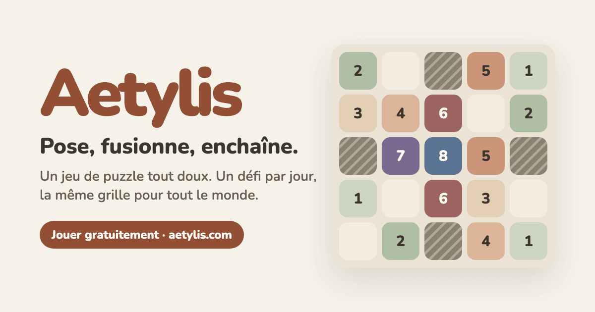
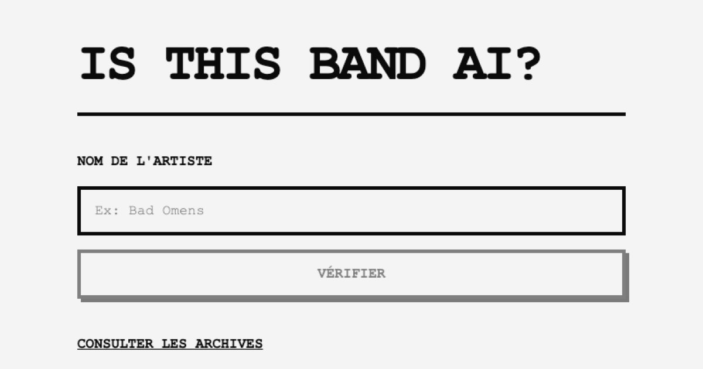
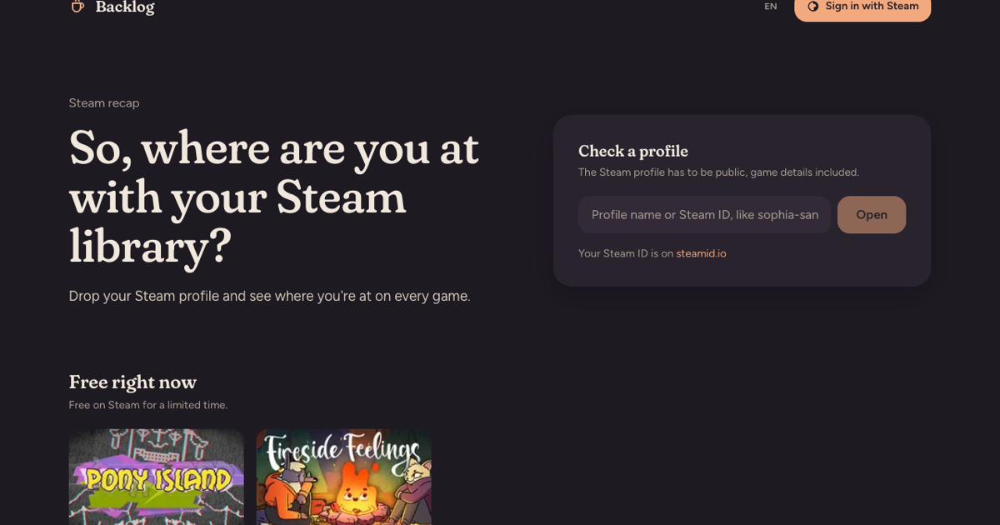
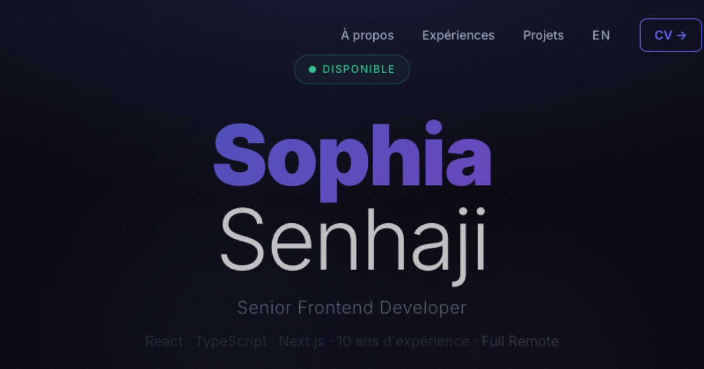

  
  
  
  
  
  

Front-end developer specializing in **React**, **Next.js**, and **TypeScript**, with a growing appetite for LLM-powered products: RAG pipelines, structured generation, agentic workflows.

🎮 Gamer, anime fan, music enthusiast &nbsp;·&nbsp; 🐈🐈 Two cats &nbsp;·&nbsp; 🇫🇷 France

Currently deep into fantasy worlds, game development, and building things people actually use.

## 🛠️ Things I've built

<table>
  <tr>
    <td width="50%" valign="top">
      
      <h3><a href="https://aetylis.com">Aetylis</a></h3>
      A cozy tile fusion puzzle game: place tiles, trigger chain reactions, chase the high score. One daily challenge, the same board for everyone. Installable as an app. The rules run on a pure TypeScript engine, fully decoupled from React.
        
      
      
      
      
    </td>
    <td width="50%" valign="top">
      
      <h3><a href="https://is-this-band-ia.vercel.app">Is This Band AI?</a></h3>
      Is that artist real, or an AI-generated project (Suno & co)? A pipeline cross-checks Spotify, MusicBrainz, Wikidata, and Setlist.fm, then falls back to Gemini with web search for the ambiguous cases. Cached, so a new artist costs close to nothing.
        
      
      
      
      
    </td>
  </tr>
  <tr>
    <td width="50%" valign="top">
      
      <h3><a href="https://steam-achievements-beta.vercel.app">Backlog</a></h3>
      Drop your Steam profile and see where you're at on every game. It uses Cloudflare browser rendering to scrape Steam guides and an LLM to turn them into structured data.
        
      
      
      
    </td>
    <td width="50%" valign="top">
      
      <h3><a href="https://sophia-senhaji.com">Portfolio</a></h3>
      Where to reach me and find my resume.
        
      
      
    </td>
  </tr>
</table>

## ✍️ Writing

> I burned out in 2024. Between that and everything since, I've come to think an ugly but honest account of this job is worth more than a polished one.

That's why I write on **[Le Substack de SophiaSan](https://projectpyxis.substack.com)**, about burnout, resilience, and the road back, so that anyone going through the same thing knows they're not alone. Start with *"Autopsie d'une développeuse épuisée"* (in French).

## 🧰 Tech I use

  

  <b>AI / LLM</b>: Gemini · prompt pipelines · grounded search · structured generation 
  <b>AI-assisted dev</b>: Claude Code · GitHub Copilot 
  <b>Code quality</b>: ESLint · Prettier · Husky

